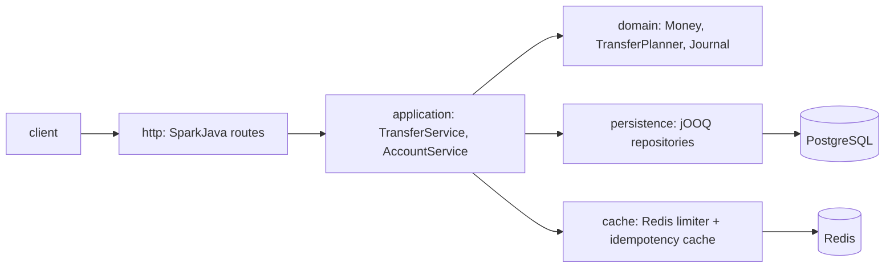

# ledger-lab

[](https://github.com/erencivril/ledger-lab/actions/workflows/ci.yml)

A small Java 21 service that moves money between accounts. Every transfer is recorded as a balanced double-entry journal, accounts can hold different currencies, and retries are safe.

It is a learning project, built the way I would build a small payments service: money invariants first, then the API around them. The stack is Java 21, SparkJava, jOOQ, Flyway, PostgreSQL 16, Redis 7, HikariCP, Jackson, Spock and Testcontainers. It is the Java companion to [paywall-lab](https://github.com/erencivril/paywall-lab), which does a similar job in Go.

## Why

The interesting part of a transfer API is not the HTTP. It is a short list of facts that must always be true, even when requests are retried or run in parallel:

1. Money is exact. No `double`, no silent rounding.
2. Every transfer is a journal whose entries add up to zero in each currency.
3. A customer balance never goes below zero.
4. A transfer to the same account is rejected, and the amount must be greater than zero.
5. A retried request does not move money twice.
6. Two transfers that touch the same accounts at the same time do not deadlock or lose an update.

The code and the tests are organised around these six facts.

## Architecture



| Package | Role | Allowed to depend on |
|---|---|---|
| `domain` | Money, currencies, FX conversion, accounts, the journal, `TransferPlanner`. Plain Java. | JDK only |
| `application` | `TransferService`, `AccountService`, and the interfaces (`Ports`) they need from the outside. | domain |
| `persistence` | jOOQ repositories, the transaction wrapper, Flyway and the connection pool. | domain, application |
| `cache` | Redis velocity limit and idempotency cache. | domain, application |
| `http` | SparkJava routes, JSON, error mapping. | domain, application |

`App` is the one place that wires everything together. An ArchUnit spec fails the build if a layer reaches into one it should not know about, for example if `domain` imports a framework.

## Design decisions

### Money is `BigDecimal` at the currency's scale

`Money` is a record of a `BigDecimal` and a `Currency`. The amount is always stored at the currency's own scale: 2 decimals for USD, 0 for JPY, 3 for KWD. The constructor does not round. If a client sends `1.005` USD the request is rejected with `invalid_amount`, because silently choosing a cent is how money goes missing. Rounding happens in one place only, currency conversion, and it is `HALF_EVEN` (banker's rounding), so a long series of conversions does not drift in one direction. Amounts travel as JSON strings and are parsed straight into `BigDecimal`, never through a double.

### Double-entry journal

A transfer writes one `transfers` row and at least two `journal_entries` rows: negative for the debited account, positive for the credited one. `Journal` is a record whose constructor throws unless the entries sum to zero in every currency, so an unbalanced journal cannot exist in the domain. A deferred constraint trigger in PostgreSQL (`V3__journal_balance_trigger.sql`) checks the same thing at commit, so a bug in the application cannot persist one either. There is an integration test that tries.

Cross-currency transfers cannot balance with two entries, because 50 USD and 46 EUR are not the same amount. They are written as four entries through a treasury account per currency: the sender is debited in USD and the USD treasury is credited, then the EUR treasury is debited and the receiver is credited in EUR. Each currency nets to zero on its own. Treasury accounts have no stored balance (it would be a hot row that every transfer in that currency locks); their balance is the sum of their entries. They are never visible through the API.

The rate that was used is stored on the transfer row. The FX table is seeded by migration `V2` and is fixed, which keeps results repeatable. The rates are illustrative, not market data.

Customer accounts keep a `balance` column next to the journal, with `CHECK (balance >= 0)`. That is a deliberate duplicate of what the entries add up to. The integration tests check that the two always agree.

### Lock ordering

`TransferService` runs one database transaction per transfer. Inside it, it locks both accounts with `SELECT ... FOR UPDATE`, always in ascending id order, regardless of which one is the sender. Then it reads the balances, asks the planner for a decision, and writes.

If two transfers between A and B ran in opposite directions and each locked its own sender first, one would hold A and wait for B while the other held B and waited for A. PostgreSQL would eventually notice and abort one of them. With a fixed order both transfers queue on the same first row, so the cycle cannot form. Reading the balances after taking the locks is what prevents two concurrent debits from both seeing the same money.

I checked this by removing the `sorted()` call once: 381 of 400 concurrent transfers failed with `deadlock detected` and the run took 85 seconds instead of 6. There is also a control test in the suite that locks two rows in opposite orders on purpose and asserts that PostgreSQL reports `40P01`. It shows the concurrency test would notice a bad ordering.

### Idempotency

`POST /transfers` requires an `Idempotency-Key` header (at most 255 characters).

- Same key, same body: `200 OK` with the original transfer and `Idempotency-Replayed: true`. The first call returns `201 Created`.
- Same key, different body: `409` with code `idempotency_key_reused`.
- "Same body" means the same source, destination, amount and currency. The amount is normalised first, so `10` and `10.00` count as the same request. The body is compared by a SHA-256 hash stored next to the key.

PostgreSQL is the source of truth. The key is claimed with `INSERT ... ON CONFLICT DO NOTHING` on the primary key of `idempotency_keys`, inside the same transaction that moves the money. If two requests with the same key arrive together, the second insert waits for the first transaction. When the first commits, the second sees a conflict and returns the stored result. When it rolls back, the second one proceeds. Because the claim and the transfer commit together, there is no state where the key exists but the money did not move.

A consequence worth knowing: a transfer that is rejected (insufficient funds, unknown account) rolls back its claim, so the same key can be used again after the client fixes the request. Some systems store failures too. This one does not.

### What Redis is and is not trusted for

Redis does two jobs and neither affects correctness.

1. **Velocity limit.** A sliding window per source account, kept in a sorted set and updated by one Lua script so the check and the update are atomic across app instances. The script uses the Redis clock. The default is 10 transfers per 60 seconds, set with `VELOCITY_MAX_TRANSFERS` and `VELOCITY_WINDOW_SECONDS`. The next one gets `429` with code `velocity_limit_exceeded` and a `Retry-After` header. The limit counts attempts that get past the idempotency lookup, so a replay of a finished transfer is free, but a transfer later rejected for insufficient funds still counts. If Redis is down the limiter lets the transfer through and logs a warning (`VELOCITY_FAIL_OPEN=false` makes it fail instead, as a 500). I chose fail-open because the ledger is correct without this rule; it is a risk control, not an integrity control.
2. **Idempotency cache.** After a transfer commits, `idem:<key>` is written with a 24 hour expiry so a replay can skip one query. A miss, a stale entry, garbage, or Redis being down all fall back to PostgreSQL. A cache entry is only used when its stored request hash matches the new request, and it only ever points at a transfer that is looked up in PostgreSQL. Nothing is ever created or moved because of what Redis says. Tests delete entries, poison them, and point the app at a Redis that is not there.

## API

Amounts are strings. Errors are always `{"code": "...", "message": "..."}`.

| Method and path | What it does |
|---|---|
| `POST /accounts` | Body: `owner`, `currency`, optional `initialBalance`. Returns `201`. An opening balance is paid by the treasury through a normal journal. |
| `GET /accounts/{id}` | Account with its balance. |
| `GET /accounts/{id}/statement?limit=20&cursor=...` | Journal entries, newest first. `limit` is 1 to 100. Pass `nextCursor` back as `cursor` for the next page; it is `null` on the last page. Each entry has the amount and the balance after it. |
| `POST /transfers` | Header `Idempotency-Key`. Body: `sourceAccountId`, `destinationAccountId`, `amount`, `currency` (the source account's currency). |
| `GET /transfers/{id}` | One transfer, including the amount on each side and the FX rate used. |
| `GET /health` | `200` while PostgreSQL is reachable. Reports Redis too: `up`, or `degraded` when Redis is down. `503` if PostgreSQL is down. |

Currencies: `USD`, `EUR`, `GBP`, `TRY`, `JPY`, `KWD`. Codes are case-sensitive.

| Status | When | Codes |
|---|---|---|
| 400 | Malformed or invalid input | `invalid_json`, `missing_field`, `invalid_field`, `invalid_id`, `invalid_amount`, `unsupported_currency`, `invalid_owner`, `missing_idempotency_key`, `invalid_idempotency_key`, `invalid_limit`, `invalid_cursor` |
| 404 | Unknown account, transfer or route | `account_not_found`, `transfer_not_found`, `route_not_found` |
| 409 | Idempotency key reused with a different body | `idempotency_key_reused` |
| 422 | The request is well formed but a rule refuses it | `same_account`, `insufficient_funds`, `currency_mismatch`, `no_fx_rate` |
| 429 | Velocity limit | `velocity_limit_exceeded` |
| 500 | Anything unexpected | `internal_error` |

Amounts that are zero, negative or have too many decimals are 400 (`invalid_amount`). An amount above 1,000,000,000,000 is also `invalid_amount`.

```sh
curl -X POST localhost:8080/accounts -H 'Content-Type: application/json' \
  -d '{"owner":"alice","currency":"USD","initialBalance":"100.00"}'
curl -X POST localhost:8080/accounts -H 'Content-Type: application/json' \
  -d '{"owner":"bob","currency":"EUR"}'

curl -i -X POST localhost:8080/transfers -H 'Content-Type: application/json' \
  -H 'Idempotency-Key: demo-1' \
  -d '{"sourceAccountId":"<alice>","destinationAccountId":"<bob>","amount":"25.00","currency":"USD"}'
# 201, destinationAmount 23.00 EUR, fxRate 0.92000000. Send it again: 200 and Idempotency-Replayed: true.
```

## Run it

You need Docker for the compose stack. For the Gradle commands you need a JDK 21; the Gradle wrapper is in the repo.

```sh
make up        # builds the image, starts app + postgres + redis, waits for healthchecks
make smoke     # two accounts, a transfer, a retry, a conflicting retry, the statement
make down      # stop and delete the database volume
```

Or without Docker for the app itself, with PostgreSQL and Redis running locally:

```sh
./gradlew run
```

Settings are environment variables:

| Variable | Default |
|---|---|
| `PORT` | `8080` |
| `DATABASE_URL`, `DATABASE_USER`, `DATABASE_PASSWORD` | `jdbc:postgresql://localhost:5432/ledger`, `ledger`, `ledger` |
| `DATABASE_POOL_SIZE` | `10` |
| `REDIS_URL` | `redis://localhost:6379` |
| `VELOCITY_MAX_TRANSFERS` | `10` |
| `VELOCITY_WINDOW_SECONDS` | `60` |
| `VELOCITY_FAIL_OPEN` | `true` |

The schema is created by Flyway when the app starts. The jOOQ classes are generated at build time from the same migration files using jOOQ's `DDLDatabase`, so building needs no running database and the generated code cannot drift from the schema.

## How it is tested

```sh
make test         # unit specs, no Docker needed
make integration  # starts PostgreSQL 16 and Redis 7 with Testcontainers
make mutation     # PIT on the domain package
make check        # unit + integration
```

**Unit specs (Spock 2 on Groovy 4).** 11 specs, 76 features, 191 test results with the `where:` rows counted. The domain is tested with data tables: rounding at 0, 2 and 3 decimals including the exact half-way cases, FX conversion, every validation rule, balanced and unbalanced journals. `TransferService` and `AccountService` are tested with mocked ports, including the order of calls and the lock order. An ArchUnit spec guards the layering.

**Integration specs.** 4 specs, 47 features, 73 test results, all against real PostgreSQL and Redis. They cover the repositories through the services, the whole HTTP API, idempotent replays, 20 parallel requests with one key (exactly one transfer), rollback of rejected transfers, the database-level guards (unbalanced journal, negative balance), the Redis limiter and its sliding window, 429 responses, and Redis being wrong, empty or unreachable. Every spec that writes money ends by running SQL that checks the invariants over the whole database: each transfer sums to zero per currency, each customer balance equals the sum of its entries, nothing is negative.

**Concurrency test.** `ConcurrencyIntegrationSpec` starts 32 threads and fires 400 transfers of random amounts between the same two accounts, half in each direction, released together by a latch. The last local run:

```
transfers=400 threads=32 direction=both ok=400 deadlocks=0 elapsed_ms=5660 total_before=20000.00 total_after=20000.000
```

All 400 succeeded and the money is conserved. The numbers are from a 2-vCPU VPS with PostgreSQL in Docker, so read them as "it works under contention", not as a benchmark. The same spec also runs 300 requests of 1.00 against an account with 100.00 (exactly 100 succeed, 200 get `insufficient_funds`, the balance ends at 0) and 200 cross-currency transfers in both directions.

**Mutation testing (PIT).** PIT changes the domain code (flips a condition, removes a call, changes a return value) and checks that a test fails. It runs on `dev.erencivril.ledger.domain` with the `STRONGER` mutator set and the JUnit 5 plugin so Spock specs are run. Last run: 94 mutants, 94 killed, 100% line coverage of the mutated classes. The build fails below a 90% threshold, set in `build.gradle`. CI uploads the HTML report as an artifact and writes the score and any surviving mutants to the job summary.

On its first runs PIT reported two survivors. The treasury map's defensive copy was never tested, and the currency check in `TransferPlanner` was hidden behind a similar check inside `Money`, so a loose assertion on the error message let the mutant live. Both became tests.

PIT only looks at the domain. The application and persistence layers are checked by the other tests, not by mutation testing.

## CI

[`.github/workflows/ci.yml`](.github/workflows/ci.yml) runs four jobs on every push to `main` and on pull requests:

1. `unit`: `./gradlew assemble test`.
2. `integration`: `./gradlew integrationTest` with Testcontainers; prints the concurrency numbers in the job summary.
3. `mutation`: `./gradlew pitest`; uploads the PIT report and writes the score to the summary.
4. `docker`: `docker compose up --build --wait`, then `scripts/smoke.sh`.

Gradle's build cache is off, so tests are never skipped as "from cache".

## Known limitations

- **No authentication or ownership.** Anyone who knows an account id can transfer from it. This is the biggest gap if it were to be used for real.
- **FX is a fixed, illustrative table.** No live rates, no spread, no fees, no rate expiry. A rate and its inverse are not exact reciprocals. Only six currencies, as an enum.
- **No reversals.** There is no refund, cancel or hold. A transfer is final once committed.
- **Idempotency keys are global and never expire.** They are not scoped to a client, and the table grows forever. A real service would scope keys per API client and delete old ones.
- **Velocity limit is simple.** Per source account only, counts attempts, and fails open by default.
- **Single PostgreSQL.** Row locks serialise transfers that share an account, which is the point, but a very busy account is a hot row. Scaling beyond one database would need partitioning by account and a different approach to cross-shard transfers (for example a saga or a transfer state machine), which this project does not have.
- **The treasury is the counterparty for FX and opening balances** and is not reconciled against anything external.
- **Operational basics are missing:** no metrics, no tracing, no request ids, no OpenAPI file, no graceful drain on shutdown beyond stopping Jetty.

## License

MIT
